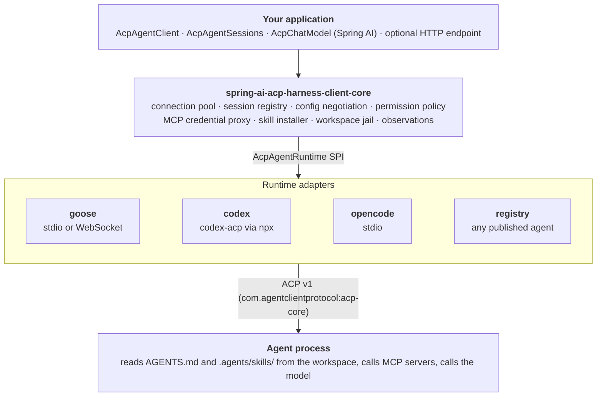

# Spring AI ACP Harness Client Reference

Spring AI ACP Harness Client drives any [Agent Client Protocol](https://agentclientprotocol.com) coding agent (Goose, Codex, OpenCode, or any of the agents in the ACP registry) from a Spring Boot application, behind one API and one configuration model.

Spring AI ACP Harness Client relates to coding agents the way Spring Data relates to databases:

- application code talks to one abstraction, `AcpAgentClient`;
- configuration carries options that work on **every** agent, plus a per-agent escape hatch;
- the agent behind it is chosen by one property, `spring.ai.acp.harness.runtime`.

```yaml title="application.yaml"
spring:
  ai:
    acp:
      harness:
        runtime: goose        # or codex, opencode, a registry id
        model: gpt-5.6-terra  # a request, not an assignment
```

```java
String answer = agentClient.prompt()
        .session("review-123")
        .user("Inspect this change")
        .call()
        .content();
```

The agent itself is a separate process: Spring AI ACP Harness Client launches it (or attaches to it), speaks ACP to it over stdio or WebSocket, supervises it, and turns what it streams back into typed Java events. Around that conversation, Spring AI ACP Harness Client configures the things that make an agent *yours*:

| Concern | What it gives the agent | Configured by |
| --- | --- | --- |
| **Runtime** | Which agent runs | `spring.ai.acp.harness.runtime` and a runtime starter ([Agent Runtimes](runtimes/index.md)) |
| **Model** | Which LLM it thinks with, and where it reaches it | `spring.ai.acp.harness.model`, `spring.ai.acp.harness.provider.*` ([Models and Providers](configuration/models.md)) |
| **MCP servers** | Tools: your APIs, databases, internal services | `spring.ai.acp.harness.mcp-servers` ([MCP Servers](configuration/mcp-servers.md)) |
| **Skills** | Procedures it loads when a task calls for them | `spring.ai.acp.harness.skills` ([Skills](configuration/skills.md)) |
| **Instructions** | A standing system prompt, always in context | `AGENTS.md` in the workspace ([Agent Instructions](configuration/agent-instructions.md)) |
| **Permissions** | Which tool calls it may make without a human | `spring.ai.acp.harness.permissions`, `spring.ai.acp.harness.mode` ([Permissions](configuration/permissions.md)) |

## Architecture



*Figure 1. Application code depends only on the top layer. Vendor knowledge lives only in the runtime adapters.*

## Three tiers of configuration

ACP standardizes the *conversation*, not the *provisioning*. So each property belongs to one of three tiers, and the tier tells you how portable it is:

| Tier | Where | Guarantee |
| --- | --- | --- |
| **Portable** | `spring.ai.acp.harness.*` | Honoured by every runtime: `workspace`, `mcp-servers`, `skills`, `permissions`, `timeout`, `provider` credentials. |
| **Negotiated** | `spring.ai.acp.harness.model`, `.mode`, `.provider.id` | A *request*. Resolved against the options the agent advertises; `on-unsupported` decides what happens when it cannot be honoured. |
| **Runtime-specific** | `spring.ai.acp.harness.runtimes.<id>.*` | Passed to that one adapter untouched and ignored by every other, so blocks for several runtimes can sit side by side. |

## Modules

| Artifact | Contents |
| --- | --- |
| `spring-ai-acp-harness-client-boot-starter-goose` | Starter plus the Goose adapter |
| `spring-ai-acp-harness-client-boot-starter-codex` | Starter plus the Codex adapter (`@agentclientprotocol/codex-acp`) |
| `spring-ai-acp-harness-client-boot-starter-opencode` | Starter plus the OpenCode adapter |
| `spring-ai-acp-harness-client-boot-starter-registry` | Starter plus the registry runtime: any agent the ACP registry publishes |
| `spring-ai-acp-harness-client-boot-starter` | Core and auto-configuration with *no* agent (for bringing your own `AcpAgentRuntime`) |
| `spring-ai-acp-harness-client-ai` | `AcpChatModel`: the agent as a Spring AI `ChatModel` |
| `spring-ai-acp-harness-client-mcp-oauth` | Per-user OAuth sign-in to MCP servers (Spring Security) |
| `spring-ai-acp-harness-client-console` | A terminal chat over the agent, for prototyping it (JLine); answers `policy: ask` |
| `spring-ai-acp-harness-client-test` | `ScriptedAcpAgent`, `AcpAgentProbe`, and the `AcpAgentRuntimeContract` conformance suite |
